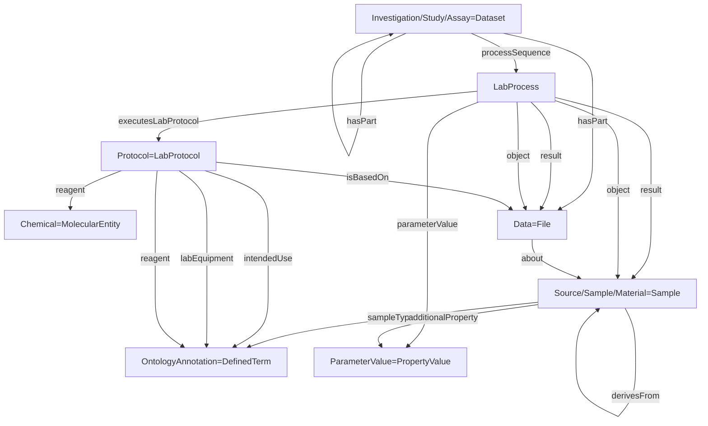

# ISA-Tox RO-Crate Profile

* Version: 0.1.0-draft.1
* Permalink: <https://w3id.org/ro/crate/isa-tox/1.0>
* Profile of: [ISA RO-Crate Profile](isa.md) (<https://w3id.org/ro/crate/isa/1.0>)
* Authors
  * Jente Houweling - https://orcid.org/0009-0005-3680-0645
* **Table of contents**
  * [Overview](#overview)
  * [Conformance](#conformance)
  * [Requirements](#requirements)
    * [MolecularEntity - Chemical](#molecularentity---chemical)
    * [Sample - Cell-based Test System](#sample---cell-based-test-system)
    * [Sample - Primary Cells](#sample---primary-cells)
    * [LabProcess - Test System Preparation](#labprocess---test-system-preparation)
    * [LabProcess - Exposure](#labprocess---exposure)
    * [LabProcess - Endpoint Readout](#labprocess---endpoint-readout)
    * [LabProcess - Data Analysis](#labprocess---data-analysis)
    * [LabProtocol - Protocol record](#labprotocol---protocol-record)
  * [Example ro-crate-metadata.json](#example-ro-crate-metadatajson)

## Overview

This profile extends the [ISA](https://isa-tools.org/index.html) [RO-Crate](https://www.researchobject.org/ro-crate/) profile
([ISA RO-Crate Profile](isa.md), originally produced by [NFDI4Plants](https://github.com/nfdi4plants/isa-ro-crate-profile))
with the entity types needed to describe experimental *in vitro* toxicology studies and New Approach Methodologies (NAMs).

It is the domain layer of a three-layer architecture: the base [RO-Crate](https://www.researchobject.org/ro-crate/)
layer provides a portable, self-describing data package on [Schema.org](https://schema.org/); the
[ISA RO-Crate Profile](isa.md) provides the structural Investigation → Study → Assay hierarchy with experimental steps
modelled as [Bioschemas](https://bioschemas.org/) `LabProcess` / `LabProtocol`; and this profile adds the
toxicology-specific, ontology-backed requirements on top.

The extension is additive and reuse-first: each concept is expressed through the most specific applicable
[Schema.org](https://schema.org/) or [Bioschemas](https://bioschemas.org/) type, refined where necessary by an existing
ontology term: a step by the protocol type of the record it executes, a test-system source by its `sampleType`. Test/control chemicals are
[bioschemas.org/MolecularEntity](https://bioschemas.org/MolecularEntity) instances; the cell-based test system's source is a
[Sample](isa.md#sample) carrying `sampleType`, either a cell line with a Cellosaurus `identifier` or primary cells
described by species and cell type; and the experimental workflow is a chain of
[LabProcess](isa.md#labprocess) steps discriminated as `TestSystemPreparation`, `Exposure`, `EndpointReadout`, and `DataAnalysis`.
No new RDF types are introduced, and no change to the base RO-Crate specification or the ISA profile is required.

Requirement levels use [RFC 2119](https://tools.ietf.org/html/rfc2119) keywords, as recommended by the RO-Crate 1.2
profile conventions: MUST (required for conformance), SHOULD (recommended; absence is reported as a warning), and
MAY (optional). 
The following graph summarises the *in vitro* toxicology workflow in terms of the profile's entity types.



> **How the reference builder encodes this.** The tables below give the canonical
> property names and expected types (what the SHACL shapes check). The
> `rocrate-wizard` builder emits them through compact JSON-LD aliases defined in
> the crate's `@context`, all RDF-identical to the canonical predicates:
>
> - `@type` is the bare token (`Sample`, `LabProcess`, `LabProtocol`,
>   `PropertyValue`, …); the `@context` expands it to the Bioschemas/schema.org
>   IRI named in the tables.
> - process parameters appear under `parameter` (→ `schema:additionalProperty`),
>   inputs under `input` (→ `schema:object`), outputs under `output`
>   (→ `schema:result`), and `derivesFrom` expands to `schema:isBasedOn`.
> - each `parameter` is a `PropertyValue` **node** with a deterministic `@id`, a
>   `propertyID` IRI and optional `unitText` — never an inline literal (the
>   LabProcess shapes use `sh:class schema:PropertyValue`).
> - a derived `Sample`'s `derivesFrom` links the Sample it was made from; only cultured
>   material is constrained: at most one cell line, or two or more for a co-culture (#678).
>
> The four LabProcess shapes are **selected by the `intendedUse` of the protocol record a
> step executes**: a term of the test system preparation types set, treatment
> protocol EFO:0003969, assay protocol BAO:0000523, data transformation OBI:0200000. A
> `LabProcess` whose record carries none of these is targeted by no tox shape and is
> checked only by the base + ISA layers, and a type outside the list is a warning. The
> `additionalType` labels older crates carry (`TestSystemPreparation`, `CellCulture`,
> `Exposure`, `EndpointReadout`, `DataAnalysis`) are read as aliases, as are growth
> protocol and transfection stated without the set. The ISA-Tox pass runs at `OPTIONAL` severity, so a missing tox MUST
> is reported but does not fail the CLI exit code (which tracks the base pass).

## Conformance

A crate following this profile declares conformance using the **RO-Crate 1.2** convention: the
*RO-Crate Metadata Descriptor*'s `conformsTo` carries only the single base-specification URI, while the
profile URIs the crate targets are declared on the **Root Data Entity** (`./`). Each referenced profile is
also declared as a `Profile` contextual entity.

```json
{
  "@id": "ro-crate-metadata.json",
  "@type": "CreativeWork",
  "conformsTo": {"@id": "https://w3id.org/ro/crate/1.2"},
  "about": {"@id": "./"}
}
```

The Root Data Entity declares the targeted profiles:

```json
{
  "@id": "./",
  "@type": "Dataset",
  "conformsTo": [
    {"@id": "https://github.com/nfdi4plants/isa-ro-crate-profile"},
    {"@id": "https://w3id.org/ro/crate/isa-tox/1.0"}
  ]
}
```

The ISA layer is declared with the IRI the profile actually extends (see
`profiles/shapes/tox/profile.ttl`, `prof:isProfileOf`); a stable `w3id.org/ro/crate/isa/…`
permalink is not yet registered. The referenced profiles are declared as contextual entities:

```json
{
  "@id": "https://github.com/nfdi4plants/isa-ro-crate-profile",
  "@type": ["CreativeWork", "Profile"],
  "name": "ISA RO-Crate Profile"
},
{
  "@id": "https://w3id.org/ro/crate/isa-tox/1.0",
  "@type": ["CreativeWork", "Profile"],
  "name": "ISA-Tox RO-Crate Profile",
  "version": "0.1.0-draft.1"
}
```

> **Note — RO-Crate 1.2 placement.** RO-Crate **1.2** recommends declaring the profiles a crate targets on the
> *Root Data Entity* (`./`) and reserving the *Metadata Descriptor*'s `conformsTo` for a single base-specification
> value — which this profile now follows (Issue #110). The earlier 1.1 placement (all URIs on the descriptor) was a
> temporary measure while the toolchain lagged: it was lifted once `rocrate-validator` 0.11.0 shipped a `ro-crate-1.2`
> base profile (crs4/rocrate-validator#164), so the base pass validates against 1.2.

A machine-readable [Profile Crate](https://www.researchobject.org/ro-crate/specification/1.2/profiles.html#profile-crate) bundling this
description with the SHACL shapes MAY additionally be published at the profile URI; this is planned but not yet provided.

## Requirements

A crate MUST include at least one Exposure that one of its Studies or Assays is about: it
is not toxicology if nothing is exposed to a chemical (#781). The check targets the Root
Data Entity, so it holds even for a crate that contains nothing else. Each Exposure's
protocol then names its compounds (see [LabProcess - Exposure](#labprocess---exposure)).

### MolecularEntity - Chemical

The test and control chemicals are modelled as [bioschemas.org/MolecularEntity](https://bioschemas.org/MolecularEntity)
instances (rather than the broader `ChemicalSubstance`), so a resolvable identifier and structure make the compound
machine-actionable. Concentration is **not** a property of the compound — it is carried per well by the
[Exposure](#labprocess---exposure)'s condition table (CSVW), so there is no per-concentration chemical Sample.

| Property | Required | Expected Type | Description |
|----------|----------|---------------|-------------|
|@id|MUST|Text or URL|A resolvable compound IRI where possible, e.g. a [PubChem](https://pubchem.ncbi.nlm.nih.gov/) or CompoundWiki entry.|
|@type|MUST|Text|MUST be '[bioschemas.org/MolecularEntity](https://bioschemas.org/MolecularEntity)'|
|name|MUST|Text|The compound name.|
|identifier|SHOULD|Text, URL or [schema.org/PropertyValue](isa.md#propertyvalue)|A compound identifier (e.g. InChIKey, CAS, PubChem CID), ideally a PropertyValue carrying its scheme, resolving to an authoritative resource.|
|inChIKey|SHOULD|Text|The hashed InChI for unambiguous structure lookup.|
|smiles|SHOULD|Text|The compound structure as SMILES.|
|inChI|MAY|Text|The compound structure as InChI.|
|molecularFormula|MAY|Text|The molecular formula.|
|url|MAY|URL|Link to an external record, e.g. PubChem, ChEBI or CompoundWiki.|

### Sample - Cell-based Test System

Is based on the Bioschemas [bioschemas.org/Sample](https://bioschemas.org/Sample) type ([ISA Sample](isa.md#sample)).
The source of the cell-based test system is a single Sample carrying a categorical annotation via `sampleType`
(a [DefinedTerm](isa.md#definedterm)). A cell line also carries a cell-line identity via `identifier` resolved to a
Cellosaurus accession; primary cells are described in [Sample - Primary Cells](#sample---primary-cells). It is
typed by its `sampleType`; cultured and exposed cells carry "cell culture" instead, so these shapes do not constrain them.
A Sample a test system preparation consumes is a source whatever it states, so one with no `sampleType` is still
reported. The labels `"CellLine"` / `"PrimaryCell"` older crates carry in `additionalType` are aliases.

| Property | Required | Expected Type | Description |
|----------|----------|---------------|-------------|
|@id|MUST|Text or URL|Could be the unique sample name, e.g. the cell-line name.|
|@type|MUST|Text|MUST be '[bioschemas.org/Sample](https://bioschemas.org/Sample)'|
|sampleType|MUST|[schema.org/DefinedTerm](isa.md#definedterm)|A categorical annotation of the test system as a fixed, resolvable ontology term (its `@id` dereferences to the term), e.g. "cell line" → [NCIT:C16403](http://purl.obolibrary.org/obo/NCIT_C16403). It SHOULD be cell line, primary cell, co-culture (NCIT:C93168) or cell culture (OBI:0001876).|
|name|MUST|Text|A name identifying the sample, e.g. the cell-line name.|
|identifier|SHOULD|Text, URL or [schema.org/PropertyValue](isa.md#propertyvalue)|The cell-line identity resolved to a [Cellosaurus](https://www.cellosaurus.org/) accession (e.g. `CVCL_0027`).|
|additionalProperty|SHOULD|[schema.org/PropertyValue](isa.md#propertyvalue) ([Characteristic](isa.md#propertyvalue---characteristic))|Characteristics of the sample, e.g. passage number or growth conditions.|
|url|MAY|URL|Link to the [Cellosaurus](https://www.cellosaurus.org/) entry.|

### Sample - Primary Cells

Is based on the Bioschemas [bioschemas.org/Sample](https://bioschemas.org/Sample) type ([ISA Sample](isa.md#sample)).
Primary cells are taken directly from donor tissue and are not immortalized. Cellosaurus holds no record for them and
assigns them no RRID ([FAQ Q19](https://www.cellosaurus.org/faq)), so the source is described by the species and the
cell type it was isolated as instead.

| Property | Required | Expected Type | Description |
|----------|----------|---------------|-------------|
|@id|MUST|Text or URL|Could be the unique sample name.|
|@type|MUST|Text|MUST be '[bioschemas.org/Sample](https://bioschemas.org/Sample)'|
|sampleType|MUST|[schema.org/DefinedTerm](isa.md#definedterm)|"primary cell" → [EFO:0002660](http://www.ebi.ac.uk/efo/EFO_0002660); its `termCode` also carries the IUCLID OHT 201 test-system type `IUCLID:108175` ("primary cells").|
|name|MUST|Text|A name identifying the sample, e.g. "kidney tubuloids, donor T19".|
|taxonomicRange|SHOULD|Text, URL or [schema.org/DefinedTerm](isa.md#definedterm)|The species the cells were taken from, e.g. NCBITaxon:9606.|
|additionalProperty|SHOULD|[schema.org/PropertyValue](isa.md#propertyvalue) ([Characteristic](isa.md#propertyvalue---characteristic))|Characteristics of the source; see expected values below. The cell type SHOULD be one.|
|identifier|MAY|Text, URL or [schema.org/PropertyValue](isa.md#propertyvalue)|A BioSamples accession, if the material was deposited. There is no Cellosaurus entry or RRID.|

**Expected `additionalProperty` items.** Each is a Characteristic [PropertyValue](isa.md#propertyvalue---characteristic)
(`additionalType` `"CharacteristicValue"`). Only the cell type is checked by a shape.

| name | Required | propertyID |
|------|----------|------------|
|cell type|SHOULD|`http://www.ebi.ac.uk/efo/EFO_0000324` (value e.g. a CL term)|
|Organ, Tissue|SHOULD|`https://w3id.org/ro/crate/isa-tox/1.0/param/organ`, `https://w3id.org/ro/crate/isa-tox/1.0/param/tissue`|
|supplier, catalogue number, lot number|SHOULD if commercial|`http://purl.obolibrary.org/obo/NCIT_C90473`, `http://purl.obolibrary.org/obo/NCIT_C99286`, `http://purl.obolibrary.org/obo/NCIT_C70848`; the lot, not the catalogue number, fixes the donor|
|donor code, number of donors|SHOULD|—|
|donor sex, age, health status|MAY|`http://purl.obolibrary.org/obo/PATO_0000047`, `http://www.ebi.ac.uk/efo/EFO_0000246`, —; age as a reported band, never a birth date|

Donor consent or ethics approval MAY be stated at [Study](isa.md#study) level, not on the Sample.

**Modelling rules.**

- A donor pool is **one** `PrimaryCell` Sample carrying the number of donors.
- Donors cultured separately are one Sample each.

### LabProcess - Test System Preparation

Is based on the Bioschemas DRAFT [bioschemas.org/LabProcess](https://bioschemas.org/LabProcess) type
([ISA LabProcess](isa.md#labprocess)), typed by its protocol record's `intendedUse`, a term of the test system preparation types set, to represent
preparation of the biological model from its source cells, such as its maintenance in culture. A test system may be
prepared in several steps, each typed by what it does. A stably modified line is the source itself, not a step.

The set is a [DefinedTermSet](https://schema.org/DefinedTermSet), `https://w3id.org/ro/crate/isa-tox/1.0/preparation-types`, published with this
profile; the term states it with `inDefinedTermSet`:

| Preparation type | Term |
|------------------|------|
|Culture, plating|[EFO:0003789](http://www.ebi.ac.uk/efo/EFO_0003789) *growth protocol*|
|Transient transfection|[OBI:0001152](http://purl.obolibrary.org/obo/OBI_0001152) *transfection*|
|Differentiation|[GO:0030154](http://purl.obolibrary.org/obo/GO_0030154) *cell differentiation*|

| Property | Required | Expected Type | Description |
|----------|----------|---------------|-------------|
|@id|MUST|Text or URL|Could identify the process using the process name and protocol reference.|
|@type|MUST|Text|MUST be '[bioschemas.org/LabProcess](https://bioschemas.org/LabProcess)'|
|name|MUST|Text|The name of the process, e.g. "Cell Culture".|
|object|MUST|[bioschemas.org/Sample](isa.md#sample)|The input source sample(s): a cell line or primary cells. At least one.|
|result|MUST|[bioschemas.org/Sample](isa.md#sample)|The output (cultured) sample(s). At least one.|
|parameterValue|MUST|[schema.org/PropertyValue](isa.md#propertyvalue) ([Parameter](isa.md#propertyvalue---parameter))|Process parameter(s); see expected values below. At least one.|
|executesLabProtocol|MUST|[bioschemas.org/LabProtocol](#labprotocol---protocol-record)|The step's protocol record: exactly one (SHOULD).|

**Expected `parameterValue` items.** Each is a Parameter [PropertyValue](isa.md#propertyvalue---parameter)
(`additionalType` `"ParameterValue"`). The profile requires at least one `parameterValue`; the following are recommended
for this step:

| name | Required | propertyID |
|------|----------|------------|
|Culture Medium|SHOULD|`http://www.bioassayontology.org/bao#BAO_0000114`|

### LabProcess - Exposure

Is based on the Bioschemas DRAFT [bioschemas.org/LabProcess](https://bioschemas.org/LabProcess) type
([ISA LabProcess](isa.md#labprocess)), typed by its protocol record's `intendedUse`, treatment protocol (EFO:0003969), to represent exposing the cell-based test system to
the chemical(s). It takes the cultured cell [Sample](isa.md#sample) as its `object`, executes a protocol record naming
the compounds it applied, and emits the exposed cell [Sample](isa.md#sample)(s) as its `result`. The experimental design
is a run-specific condition table (CSVW): a data file `about` those exposed Samples, in which each row records a single
well (cell line, compound, concentration, exposure duration).

> **Where the compound goes.** The [MolecularEntity](#molecularentity---chemical) compound is **not** a process
> `object`: the inherited ISA [LabProcess](isa.md#labprocess) shape restricts `schema:object` (and `schema:result`)
> to `File`/`Sample`/`BioSample`, so a `MolecularEntity` there fails validation. The compound is a `reagent` of the
> Exposure's [protocol record](#labprotocol---protocol-record), which MUST name at least one. The procedural SOPs name no
> compound and are what the record `isBasedOn`, so the assay stays executable with other chemicals: a re-run needs a new
> record and condition table and the same SOPs.

| Property | Required | Expected Type | Description |
|----------|----------|---------------|-------------|
|@id|MUST|Text or URL|Could identify the process using the process name and protocol reference.|
|@type|MUST|Text|MUST be '[bioschemas.org/LabProcess](https://bioschemas.org/LabProcess)'|
|name|MUST|Text|The name of the process, e.g. "Exposure".|
|object|MUST|[bioschemas.org/Sample](isa.md#sample) or [File](https://schema.org/MediaObject)|The input cell sample(s) being exposed. At least one. (A `MolecularEntity` is **not** allowed here — see note above.)|
|parameterValue|MUST|[schema.org/PropertyValue](isa.md#propertyvalue) ([Parameter](isa.md#propertyvalue---parameter))|Exposure parameter(s); see expected values below. At least one.|
|result|MUST|[bioschemas.org/Sample](isa.md#sample) or [File](https://schema.org/MediaObject)|The exposed sample(s) the step produces. At least one. The condition table is **not** a result: it is a `File` + `csvw:Table` `about` the exposed Samples, and each exposure SHOULD have one.|
|executesLabProtocol|MUST|[bioschemas.org/LabProtocol](#labprotocol---protocol-record)|The step's protocol record: exactly one (SHOULD), whose `reagent`s MUST include at least one test or control compound (a MolecularEntity).|

**Expected `parameterValue` items.** Each is a Parameter [PropertyValue](isa.md#propertyvalue---parameter)
(`additionalType` `"ParameterValue"`). The profile requires at least one `parameterValue`; the following are recommended
for this step:

| name | Required | propertyID |
|------|----------|------------|
|Exposure Duration|SHOULD|`http://purl.obolibrary.org/obo/NCIT_C83280`|
|Cell Seeding Density|SHOULD|`http://purl.obolibrary.org/obo/MSIO_0000062`|
|Microplate|SHOULD|`http://purl.obolibrary.org/obo/NCIT_C43377`|

### LabProcess - Endpoint Readout

Is based on the Bioschemas DRAFT [bioschemas.org/LabProcess](https://bioschemas.org/LabProcess) type
([ISA LabProcess](isa.md#labprocess)), typed by its protocol record's `intendedUse`, assay protocol (BAO:0000523), to represent measurement of the assay endpoint.

| Property | Required | Expected Type | Description |
|----------|----------|---------------|-------------|
|@id|MUST|Text or URL|Could identify the process using the process name and protocol reference.|
|@type|MUST|Text|MUST be '[bioschemas.org/LabProcess](https://bioschemas.org/LabProcess)'|
|name|MUST|Text|The name of the process, e.g. "Endpoint Readout".|
|object|MUST|[bioschemas.org/Sample](isa.md#sample) or [File](https://schema.org/MediaObject)|What the step measured: the exposed Sample(s) (the cultured Sample in an assay with no exposure), or the File(s) a re-analysis measures. At least one.|
|result|MUST|[File](https://schema.org/MediaObject)|The output data file(s). At least one.|
|parameterValue|MUST|[schema.org/PropertyValue](isa.md#propertyvalue) ([Parameter](isa.md#propertyvalue---parameter))|Measurement parameter(s); see expected values below. At least one.|
|executesLabProtocol|MUST|[bioschemas.org/LabProtocol](#labprotocol---protocol-record)|The step's protocol record: exactly one (SHOULD).|

**Expected `parameterValue` items.** Each is a Parameter [PropertyValue](isa.md#propertyvalue---parameter)
(`additionalType` `"ParameterValue"`). The profile requires at least one `parameterValue`; the following are recommended
for this step:

| name | Required | propertyID |
|------|----------|------------|
|Detection Instrument|SHOULD|`http://www.bioassayontology.org/bao#BAO_0000697`|
|Instrument Manufacturer|SHOULD|`http://www.bioassayontology.org/bao#BAO_0002628`|
|Measured Entity|SHOULD|`http://www.bioassayontology.org/bao#BAO_0002001`|
|Technical replicate|SHOULD|`http://www.ebi.ac.uk/efo/EFO_0002090`|
|Endpoint|SHOULD|`http://www.bioassayontology.org/bao#BAO_0000179`|
|Assay Kit|MAY|`http://www.bioassayontology.org/bao#BAO_0000248`|
|Substrate|MAY|`http://www.bioassayontology.org/bao#BAO_0003063`|

> **Note.** The `propertyID` IRIs above record exactly what the reference builder emits and are not yet normalised to a
> single resolver; their curation and the mechanism that scores these parameters against the OECD / community reporting
> standards are described in [`../mit/docs/MIT_METADATA_WIRING.md`](../mit/docs/MIT_METADATA_WIRING.md).

### LabProcess - Data Analysis

Is based on the Bioschemas DRAFT [bioschemas.org/LabProcess](https://bioschemas.org/LabProcess) type
([ISA LabProcess](isa.md#labprocess)), typed by its protocol record's `intendedUse`, data transformation (OBI:0200000), to represent the processing pipeline that turns the
raw endpoint measurements into the reported results. It consumes the [Endpoint Readout](#labprocess---endpoint-readout)'s
raw-data File(s) and emits the processed-data File(s) along the derivation graph. It corresponds to the *Analysis and
Statistics* module of the Minimal Information Table.

| Property | Required | Expected Type | Description |
|----------|----------|---------------|-------------|
|@id|MUST|Text or URL|Could identify the process using the process name and protocol reference.|
|@type|MUST|Text|MUST be '[bioschemas.org/LabProcess](https://bioschemas.org/LabProcess)'|
|name|MUST|Text|The name of the process, e.g. "Data Analysis".|
|object|MUST|[File](https://schema.org/MediaObject) or [bioschemas.org/Sample](isa.md#sample)|The raw-data input(s) being analysed. At least one.|
|result|MUST|[File](https://schema.org/MediaObject)|The processed-data output file(s). At least one.|
|parameterValue|MUST|[schema.org/PropertyValue](isa.md#propertyvalue) ([Parameter](isa.md#propertyvalue---parameter))|Analysis parameter(s); see expected values below. At least one.|
|executesLabProtocol|MUST|[bioschemas.org/LabProtocol](#labprotocol---protocol-record)|The step's protocol record: exactly one (SHOULD), which SHOULD be `isBasedOn` the deposited analysis script (a File co-typed `SoftwareSourceCode` and `LabProtocol`).|

**Expected `parameterValue` items.** Each is a Parameter [PropertyValue](isa.md#propertyvalue---parameter)
(`additionalType` `"ParameterValue"`). The profile requires at least one `parameterValue`; the following are recommended
for this step (drawn from OHT 201's *Data & Analysis* module):

| name | Required |
|------|----------|
|Data Calculation and Statistics|SHOULD|
|Computational Tool|SHOULD|
|Acceptance Criteria|MAY|
|Evaluation Criteria|MAY|

### LabProtocol - Protocol record

Is based on the Bioschemas [bioschemas.org/LabProtocol](https://bioschemas.org/LabProtocol) type
([ISA LabProtocol](isa.md#labprotocol)). Each LabProcess above executes exactly one: a record of the protocol its step
follows, present whether or not the lab deposited a document for it, because its `intendedUse` says what kind of step
it is. A deposited SOP or script stays a `File` co-typed `LabProtocol` (the RO-Crate 1.2 multi-type idiom) and is what
the record is `isBasedOn`, so one document can serve several steps, each record carrying its own type. ISA-JSON has no
`isBasedOn` on a protocol, so that link is lost on conversion to ISA-JSON.

| Property | Required | Expected Type | Description |
|----------|----------|---------------|-------------|
|@id|MUST|Text or URL|One record per step, e.g. the process `@id` followed by `_protocol`.|
|@type|MUST|Text|MUST be '[bioschemas.org/LabProtocol](https://bioschemas.org/LabProtocol)'|
|intendedUse|SHOULD|[schema.org/DefinedTerm](isa.md#definedterm)|The protocol type of its step, from the table below, written as `{"@id": …}` and described once in the graph.|
|name|SHOULD|Text|The name of the protocol, e.g. "Exposure protocol".|
|description|SHOULD|Text|What the lab stated about the procedure; a builder writes none of its own.|
|url|MAY|URL|Where the lab published the procedure, when it stated one.|
|reagent|MUST|[bioschemas.org/MolecularEntity](#molecularentity---chemical)|On the Exposure's record: the test and control compounds it applied, at least one.|
|isBasedOn|MAY|[File](https://schema.org/MediaObject)|The deposited documents the step follows.|

| Step | intendedUse |
|------|-------------|
|Test System Preparation|a term of the [test system preparation types](#labprocess---test-system-preparation) set|
|Exposure|[EFO:0003969](http://www.ebi.ac.uk/efo/EFO_0003969) *treatment protocol*|
|Endpoint Readout|[BAO:0000523](http://www.bioassayontology.org/bao#BAO_0000523) *assay protocol*|
|Data Analysis|[OBI:0200000](http://purl.obolibrary.org/obo/OBI_0200000) *data transformation*: no protocol-type term exists, so the OBI process class stands in, as ISA's reference dataset BII-I-1 does for extraction|

## Example ro-crate-metadata.json

A worked example crate is planned but not yet provided. A crate built by the reference builder types each step by
its protocol record's `intendedUse` and each test-system source by its `sampleType`, as described above,
and is validated in three passes (base RO-Crate 1.2 → ISA → ISA-Tox).
